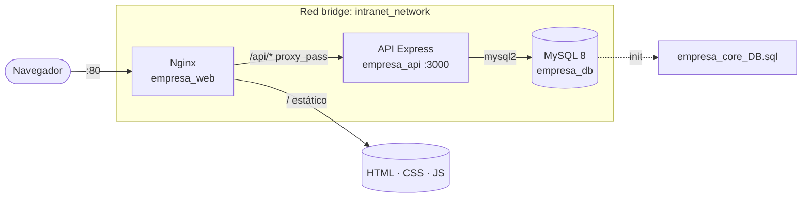

<div align="center">

# 🏢 Intranet Corporativa · Empresa Core

**Intranet de RR. HH. contenerizada: frontend web, API REST en Node.js y MySQL orquestados con Docker Compose y servidos detrás de Nginx como proxy inverso.**


<sub>Proyecto de 1º ASIR · 3.er trimestre · Lenguajes de Marcas + Gestión de Bases de Datos</sub>

</div>

---

## 📌 Qué es

Una intranet para gestionar la plantilla de una empresa ficticia: empleados, departamentos, proyectos, salarios y equipos informáticos. La parte interesante no es solo la web, sino **cómo se despliega**: tres contenedores aislados en una red bridge propia, con la base de datos inicializada automáticamente y la API publicada a través del proxy inverso.

## 🧱 Arquitectura



| Servicio | Imagen | Función |
|---|---|---|
| `web` | `nginx:alpine` | Sirve el frontend y hace de **proxy inverso** de `/api/` hacia la API |
| `api` | `node:18-alpine` (Dockerfile propio) | API REST con Express y `mysql2` |
| `db` | `mysql:8.0` | Base de datos `empresa_core`, cargada en el primer arranque desde el `.sql` |

## ⚙️ Funcionalidades

- **Login por roles** (`admin` / `empleado`) contra la API.
- **Dashboard** con contadores en tiempo real (empleados, proyectos, departamentos…).
- **Empleados**: listado, contratación, traslado de departamento y despido.
- **Operaciones** críticas implementadas como **transacciones SQL con `ROLLBACK`**: si un paso falla, no queda nada a medias.
- **Salarios**: historial salarial y actualización de sueldos.
- Modelo relacional de **12 tablas** (departamentos, puestos, empleados, credenciales, proyectos, equipos, incidencias, formación, auditoría…).

## 🚀 Puesta en marcha

```bash
git clone https://github.com/RUYA237/3-TRIMESTRE-LM-MACAR.git
cd 3-TRIMESTRE-LM-MACAR
cp .env.example .env        # y cambia DB_PASSWORD
docker compose up -d --build
```

Abre `http://localhost` → login de demo `admin` / `1234`.

| Puerto host | Servicio |
|---|---|
| `80` | Intranet (Nginx) |
| `3000` | API directa |
| `3307` | MySQL (para conectar con un cliente) |

## 🔐 Notas de seguridad

Es un **entorno de laboratorio**. Lo que haría antes de llevarlo a producción:

- [x] Credenciales de la BD fuera del repositorio (`.env` ignorado, `.env.example` como plantilla).
- [ ] Usuarios de la intranet en la tabla `credenciales_acceso` con hash **bcrypt** (la dependencia ya está incluida) en vez de credenciales de demo en `auth.js`.
- [ ] Sesiones con **JWT** o cookies `HttpOnly` y middleware de autorización por rol en cada endpoint.
- [ ] Usuario de MySQL con privilegios mínimos en lugar de `root`, y no exponer el `3307` fuera del host.
- [ ] HTTPS en Nginx y cabeceras de seguridad (`CSP`, `X-Frame-Options`, `HSTS`).
- [ ] Restringir `cors()` al origen de la intranet.

## 📁 Estructura

```
├── api/                 # API REST (Express) + Dockerfile
│   ├── server.js        # Endpoints
│   ├── auth.js          # Login
│   ├── database.js      # Pool de conexiones mysql2
│   └── consultas_estudiantes.js  # Consultas y transacciones
├── routes/              # Páginas: dashboard, empleados, operaciones, salarios
├── styles/  js/         # Frontend
├── nginx.conf           # Proxy inverso /api → api:3000
├── docker-compose.yml
└── empresa_core_DB.sql  # Esquema y datos de ejemplo
```

---

<div align="center"><sub>Hecho por <a href="https://github.com/RUYA237">Raúl Yagüe</a> · Estudiante de ASIR especializado en ciberseguridad</sub></div>
